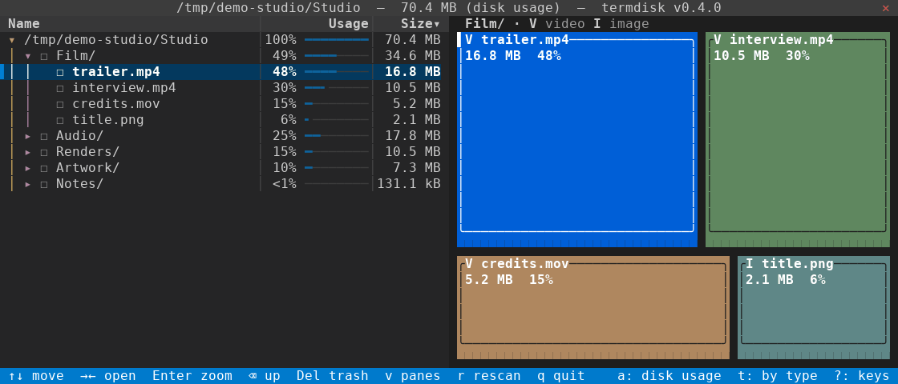
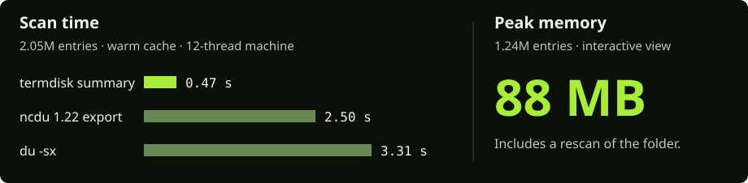
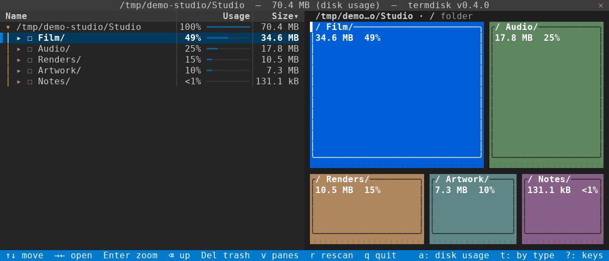
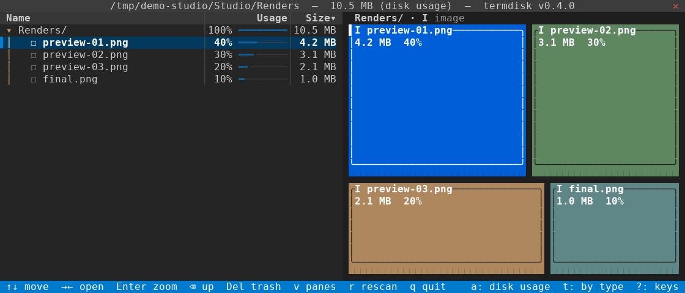

#  termdisk



Find what’s taking up space on Linux. Browse folders on the left and see their largest files on the right.

## Install

1. Open a terminal on Linux. If you don’t have Rust 1.93 or newer, follow the [Rust installer](https://rust-lang.org/tools/install/) and reopen your terminal. It includes Cargo.
2. Install termdisk with Cargo.

   ```sh
   cargo install termdisk --locked
   ```

3. Try a read-only scan of your Downloads folder.

   ```sh
   termdisk --read-only ~/Downloads
   ```

Press `q` to quit or `?` for shortcuts. To choose a folder and enable moving files to Trash, run `termdisk` on its own.

## Speed & memory



[Benchmark script](scripts/bench.sh)

## See it in action

**Explore by click.** Double-click a folder in the tree to expand it. Click a file inside and the treemap switches to that folder, highlighting the file.



**Drag to clean up.** Drag across the checkboxes, press `Del`, then review the paths and click **Move to Trash**. You can restore the files from your file manager’s Trash.



## License

© 2026 JonasAtelier · [GPL-3.0-only](LICENSE) · [Third-party notices](THIRD-PARTY-LICENSES)
