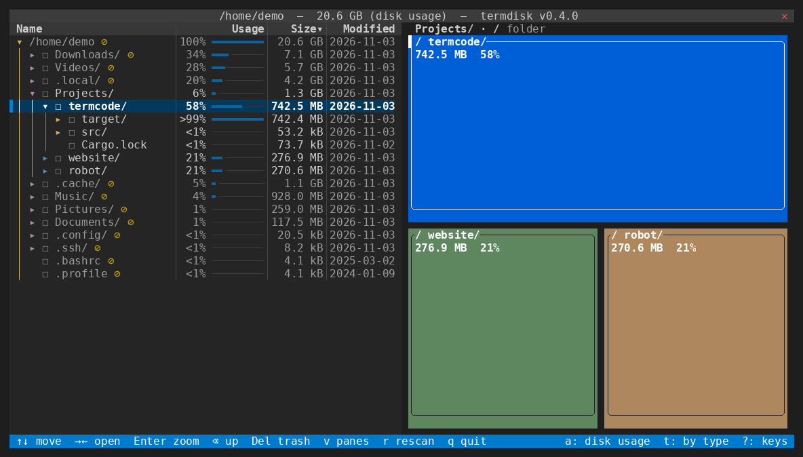
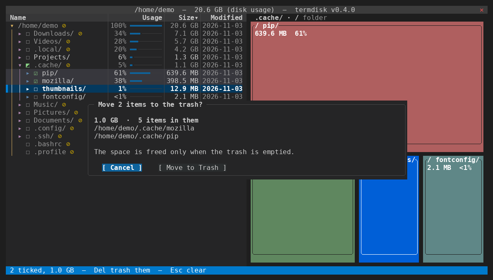
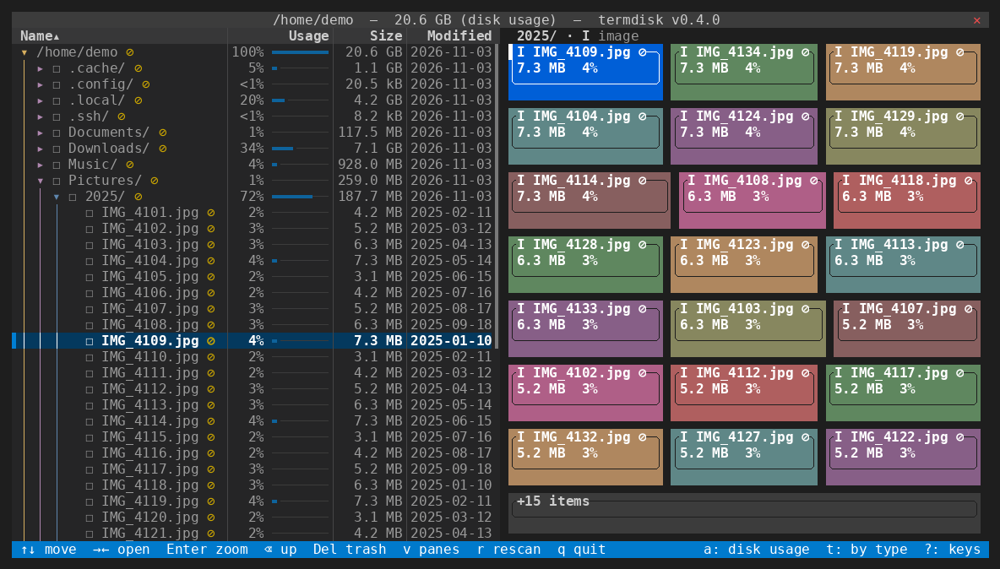

# termdisk

A disk usage analyzer for the terminal, in pure Rust: the terminal counterpart of GNOME's
Disk Usage Analyzer (baobab), with its treemap, made for finding what is big and clearing
caches and temporary files.



- Fast: a home folder of 2 million entries scans in about half a second (see Speed).
- A folder tree and a treemap side by side, keyboard and mouse.
- Careful: it only moves things to the trash, and refuses what you would miss (see what it
  refuses, below); emptying the trash, for good, is a separate step that asks first.
- A library without terminal code, so another program can embed the view.

<details>
<summary>More screenshots</summary>

Two caches ticked with Space and moved together: termdisk asks first, lists every whole path,
and Cancel has the focus.



A folder of photos sorted by name: four levels of the tree with their guides, and the treemap
of the folder that holds the selected file.



</details>

The pictures are of a demo folder, taken in a 120x34 terminal with `TERMDISK_ICONS=unicode`.

## Install

```
cargo install termdisk
```

Or the latest from the repository:

```
cargo install --git https://github.com/JonasAtelier/termdisk --locked
```

Needs Linux and Rust 1.93 or newer. Moving to the trash needs Linux 5.8 or newer (on an
older kernel termdisk only looks). A Nerd Font and a mouse are used when there, not needed.

## Use

```
termdisk                    choose a place: home, cache, /tmp or the trash
termdisk PATH               scan PATH and show it
termdisk --read-only PATH   the same, with no way to move anything to the trash
termdisk --summary [PATH]   scan PATH (default: the current folder) and print its totals
```

The left pane is the folder tree (name, usage: the share of its folder as a percentage and a
bar, size, items, last change), folders first, largest first. A click on a column heading
sorts it by that column (Usage by size), a second click the other way round; `s` and `S` do
the same from the keyboard. Folders stay on top either way. Names go A to Z (capitals and
small letters together), sizes, item counts and changes largest or newest first, and the
heading sorted by has an arrow. Each level of the tree has a guide line, and guides, chevrons
and folder icons are coloured by level (soft gold, orchid, steel blue in turn). The right pane is a
treemap of the folder that holds the selected row, that row's tile in blue (a folder, open
or not, is shown among its neighbours; its items show once a row inside it is selected); on
the shown folder's own row, of that folder. Always largest first, in rows read left to right
and top to bottom; the tiles of a row share their top and bottom. Every tile has a frame, the
selected one a white frame and the mark in its corner, and shows its whole name, its size
and its share of the folder (as the Usage column); nothing on it is cut. Areas follow the
sizes compressed (`size ^ 0.6`), so a folder of a few very large items and many small ones
still shows many, the larger ones larger. The rows break where that gives the most items a
tile, and only the items that cannot have one share the last tile, "+N items", which lists
them inside its frame, largest first, with their sizes and shares (a line only where it fits
whole, "+N more" for the others; the selected one reversed).
Selecting in one pane selects in the other. Folders in the tree start closed.

| Key | |
|---|---|
| ↑ ↓ PgUp PgDn Home End | move |
| → ← (or + -) | open, close a folder |
| double click on a folder in the tree | open it where it is; again: close it |
| Enter, double click on a tile | show that folder |
| Backspace | show the folder above |
| Del | move to the trash (asks first): the ticked items, else the selected one |
| Del on the Trash (a place, or its row) | empty the trash for good (asks first) |
| Space, a click on a row's box, drag over the rows | tick, untick, a folder with all in it (Esc clears the ticks) |
| o | open with the default program |
| c | copy the path (OSC 52) |
| a | disk usage / apparent size |
| t | map letters: by type / by age |
| s, S | sort the tree: next column / the other way round |
| click on a column heading | sort the tree by it; again: the other way round |
| v | tree and map / tree / map |
| r | scan again (what is shown, open and selected stays) |
| ? | all the keys |
| q, click on the red ✕ at the top right | quit |

Every row but the shown folder's has a tick box in its icon's place (`☐` `☑`, `[ ]` `[x]` in
ASCII); a click on it ticks or unticks the row, and a drag from it gives the rows it goes over
the same state. A ticked folder ticks everything in it. Taking the tick off one item in it
takes off only that item: the folder's tick goes, and everything else in it stays ticked, each
on its own. A folder that is not ticked but holds a ticked item shows `◩` (`[-]`), even when
all in it is ticked (the folder itself would not go); a click there ticks the whole folder.
The status bar counts what is ticked on its own (a ticked folder is one). Del moves what
shows ticked: a ticked folder that may go goes whole; one that cannot is listed as not moved,
and if what is in it may still go (it protects only itself, as `~/.cache` and Downloads, or
holds a locked item), each item in it is checked on its own.

In the dialog for Del, Cancel has the focus, so Enter alone cancels; Tab (or an arrow) moves
the focus at once, and Enter on Move to Trash, or a click on it, moves the item. For half a
second after the dialog opens nothing moves (Move to Trash is crossed out meanwhile, with the
focus or without): Enter there does nothing until then. An item that cannot be trashed itself shows a lock (`⊘`, or `!` in ASCII), and Del on
it says why; with the pointer on the lock, a box says why too. A folder that only holds such
an item shows no lock, and cannot be trashed either: Del on it says how many locked items it
holds. After a move the status bar says what went and how big it was until the next key or
click, which also does what it always does, and the folder is scanned again at once, as `r`
does: the scan's card shows meanwhile (the last tree is let go, so the memory does not
double), then the same folders stay open and the same row selected (Esc stops it and goes
back to the places). With ticked items
the dialog lists every path to move, whole, in a list that scrolls, and the ticked items that
cannot go with why; Move to Trash works once every path has been on screen, and each item
then goes through the same checks, one at a time.

Del on the start screen's Trash scans the trash, then asks to empty it: how many items, how
much disk, and that they are deleted permanently, with the same focus and waits as the dialog
for Del (Empty Trash in place of Move to Trash). Del on the trash folder's own row does the
same while browsing it. Everything in `files` goes, then its `.trashinfo`, and
`directorysizes`; the trash folders stay. It runs on a thread of its own under a card (Esc
stops it: the item it is at stays in the trash, partly deleted), then the status bar says
how many items went and how much was freed, and what could not go and why, and the trash is
scanned again. It deletes only
through the folders it holds open, never through a symbolic link (one in the trash is removed
itself) or into a mount point, only what is yours, and changes no permissions: what a
read-only folder in the trash holds stays, and is reported. Not with `--read-only`.

The map's tiles take 8 colours in turn, so neighbouring tiles differ, and only the selected
tile is blue (with a white frame and the mark in its corner). Each tile starts with its class letter, by type (from
the name only) or, with `t`, by the age of the last change, explained in the legend above the
map after the name of the folder it shows (`/` folder, `V` video, `I` image, `A` audio, `Z`
archive, `D` document, `T` code and text, `O` other; `W` this week, `M` this month, `Y` this
year, `O` older). The items at the right of the status bar (`a`, `t`, `?`) can be clicked.

The scan reads folders on several threads. It never follows symbolic links (only the path
given is resolved, as `cd` would), stays on PATH's filesystem (mount points under it, bind
mounts too, are listed but not entered), counts hard-linked files once, and gives both disk
usage (allocated blocks, as `du`) and apparent size (file lengths, as `du -b`).

termdisk deletes nothing but what you empty from your trash: it moves one item at a time to
the trash (`~/.local/share/Trash`), where the file manager can put it back. If the trash is
not there yet, it is made (mode 0700) as the first item goes, `~/.local/share` too if
needed (inside your home only), never through a symbolic link. It refuses, whole with
everything in them: `~/.config`, `~/.local`, `~/.var`, `~/snap`, browser and mail profiles
(`.mozilla`, `.thunderbird`), keys and credentials (`.ssh`, `.gnupg`, `.aws`, `.kube`,
`.docker`, `.netrc`, `.git-credentials`, ...), shell setup and history, `.claude`, synced
folders (`Dropbox`, `OneDrive`, `Nextcloud`, ...), and Desktop, Documents, Pictures and Music.
`~/.cache`, Downloads and Videos are protected themselves only: what is in them may go. It
also refuses anything not wholly yours, anything with a mount point in it, and anything on
another filesystem than the trash (where `/tmp` is a tmpfs, that includes `/tmp`). To protect
more, list paths in `~/.config/termdisk/protect`, one per line (absolute or `~/...`). It does
nothing at all when run as root or setuid.

## Speed

Measured on one 12-thread machine with a warm cache, on a home folder of 2.05 million
entries (`scripts/bench.sh` repeats it):

| | Time | Max memory |
|---|---|---|
| `termdisk --summary` | 0.47 s | 155 MB |
| `ncdu -x -0 -o /dev/null` (1.22) | 2.50 s | — (it keeps no tree) |
| `du -sx` | 3.31 s | 209 MB |

The view is up when the scan ends, draws a 300×80 screen in about 0.6 ms (1.4 ms with a
folder of 166 000 files on the map), and does nothing at all while nothing happens. With a
cold cache the disk sets the pace: the same scan takes seconds.

Memory, measured later on a home of 1.24 million entries: the tree takes 58 bytes per entry;
`--summary` peaks at 87 MB and the view at 88 MB, a scan again (`r`, or after a trash)
included, since the last tree is let go before the new one is built.

## Limits

- Linux only.
- No permanent delete but emptying the home trash. The trash folders on other disks
  (`.Trash-1000` at their top) are not emptied: use the file manager, or `gio trash --empty`.
- Emptying refuses a trash outside your home (`XDG_DATA_HOME` set elsewhere), and leaves what
  a read-only folder in it holds (make that folder writable first).
- What is on another filesystem than your trash can be looked at, not moved (`/tmp` where it
  is a tmpfs, other disks).
- Caches kept under `~/.config`, `~/.local` and `~/.var` (Electron and Flatpak programs) are
  inside protected folders and cannot be moved.
- The treemap shows one level: the folder that holds the selected row. An item gets a tile of
  its own only with room for its whole name, size and share (and 4 rows), so in a small
  window, in a folder of many files of about one size, or for a name wider than the map, many
  share the "+N items" tile. Areas rank the sizes rather than measure them (`size ^ 0.6`):
  read the size and share on the tile. A small item with a long name needs a wide tile, so it
  can be drawn larger than a larger neighbour (which keeps half its area at least); the share
  on each tile tells the truth. An item no strip has room for goes to "+N items" and the
  items after it keep their tiles, but for 8 such items in a folder at most: a run of 9 or
  more in a row that no strip can hold still hides the items after them.
- Esc during a scan again stops it and goes back to the places: the last tree was let go
  when the scan started.
- The checks before a move read every folder in what goes, while the view waits: with
  thousands of ticked items, or one huge folder on a cold disk, Del and Move to Trash can take
  seconds.

## Look

termdisk looks like termcode: its default colours (VS Code's dark theme; the tree's levels
in soft gold, orchid and steel blue, the map's tiles in soft earthy colours) and its three icon sets. The colours are
fitted to what the terminal shows, from `COLORTERM` and `TERM`; set `TERMDISK_COLORS=truecolor`,
`256` or `16` where that guess is wrong (tmux without true colour, some ssh sessions). The
icons are a Nerd Font's when one is installed (asked of fontconfig as termcode does; Unicode
over ssh); set `TERMDISK_ICONS=nerd`, `unicode` or `ascii`. A terminal that draws East Asian
Ambiguous characters two cells wide (a CJK locale setting in some terminals) misplaces the
Unicode set's arrows, bars, box lines and the tree's guides: use `TERMDISK_ICONS=ascii`
there. The selection, the lock on what cannot be trashed and the dialog's focus also show
without colour: a mark at the row's edge, the mark in the selected tile's corner, a lock sign, bold and
crossed-out buttons; the tree's levels show by their indent and guides.

## Third-party

The default colours are VS Code's (Copyright (c) Microsoft Corporation, MIT License; the full
text is in `THIRD-PARTY-LICENSES`). Colour fitting and the icon sets are adapted from
termcode (MIT, the same author).

## Build

```
cargo build --release   # Rust 1.93 or newer
cargo test
```

`AGENTS.md` describes the source files, the checks and the version rule; `CHANGELOG.md` what
changed in each version.

## License

© 2026 JonasAtelier, GPL-3.0-only, see `LICENSE`.

termdisk is free software: you can redistribute it and/or modify it under the terms of the
GNU General Public License version 3 as published by the Free Software Foundation (that
version only). It is distributed in the hope that it will be useful, but WITHOUT ANY
WARRANTY; without even the implied warranty of MERCHANTABILITY or FITNESS FOR A PARTICULAR
PURPOSE. See the GNU General Public License in `LICENSE` for more details.

Versions up to and including 0.2.0 were released under the MIT license.
